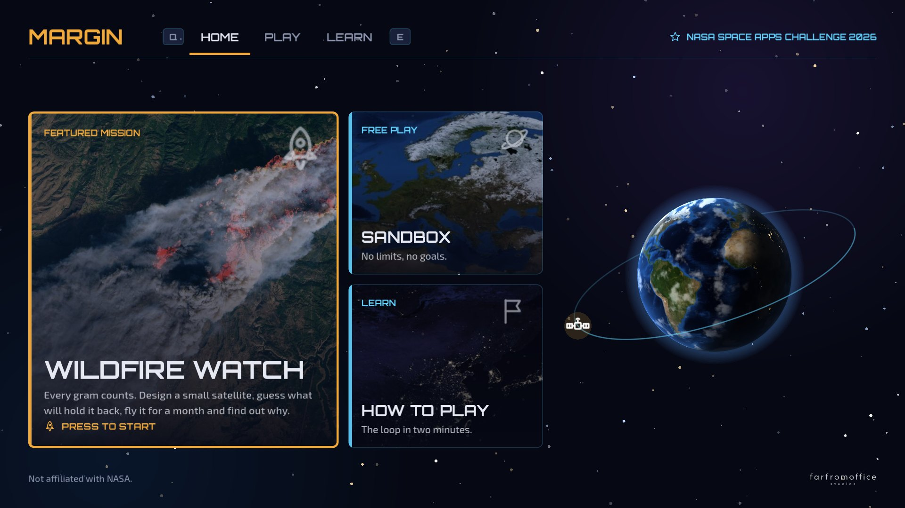
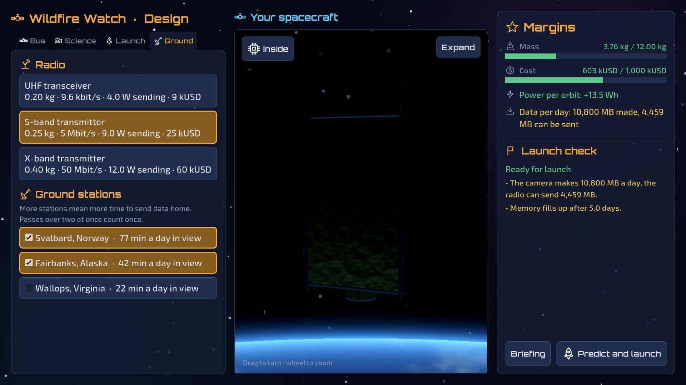
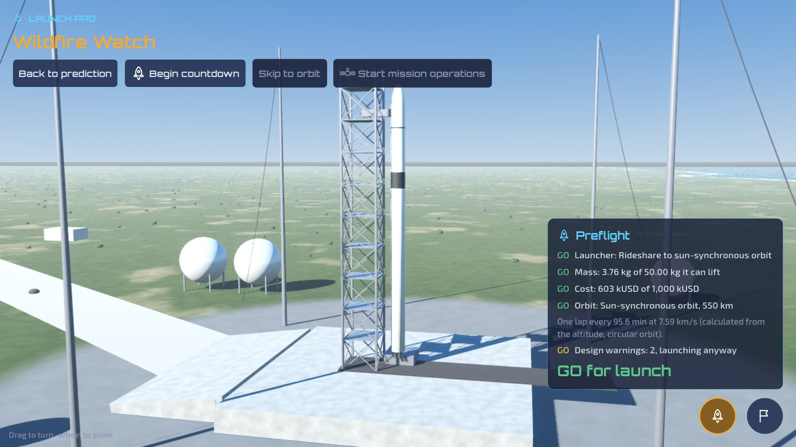
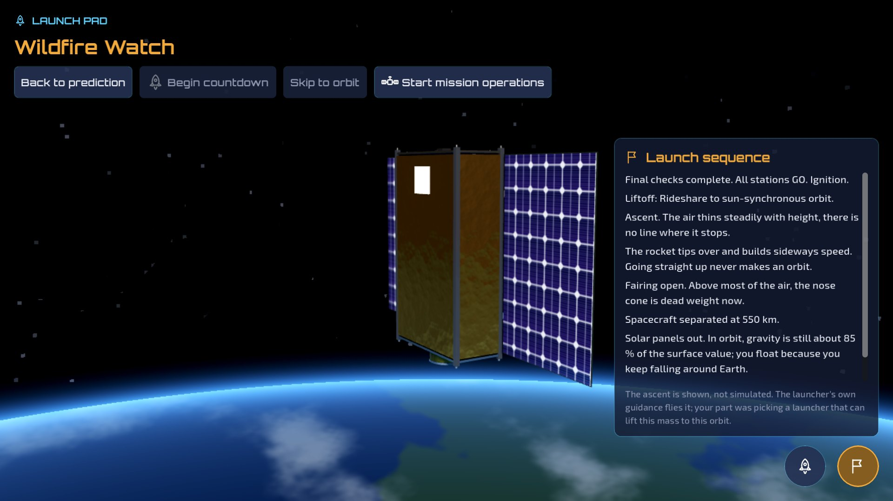
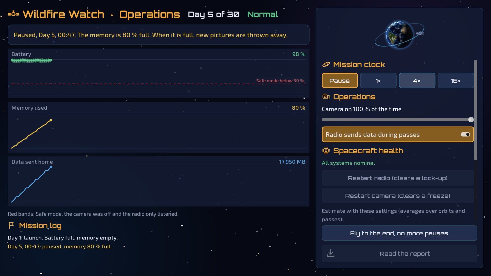
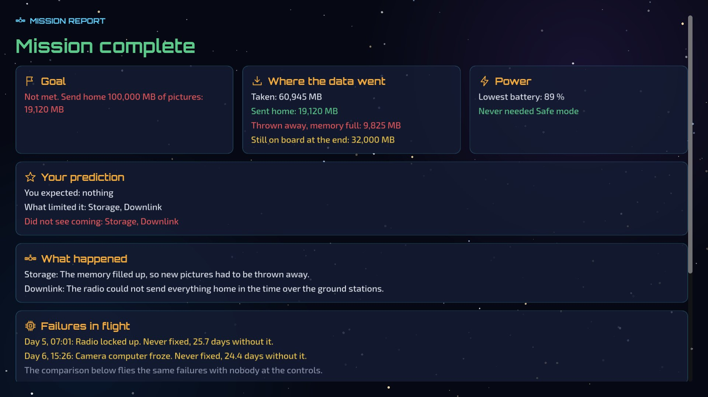

# Margin

**Every gram counts.**

Margin is a space mission design game made for the NASA Space Apps Challenge 2026 ([Space Mission Design Game](https://www.spaceappschallenge.org/2026/challenges/space-mission-design-game/)). You design a small Earth-observation mission, predict what will limit it, run it and find out why.

## Download

Get the latest build from the [releases page](https://github.com/farfromoffice/margin/releases/latest):

- Linux: margin-linux-x86_64.zip, unzip it and run margin.x86_64
- Windows: margin-windows-x86_64.zip, unzip it and run margin.exe

## Gameplay

[](https://www.youtube.com/watch?v=WDuPJPrpfrY)

| | |
|:---:|:---:|
|  |  |
| Main menu | Pick the parts, watch the margins |
|  |  |
| Preflight check on the pad | Separation and deployment in orbit |
|  |  |
| Fly the mission and handle failures | Read the report, then try again |

## Playing

1. Read the mission briefing and its objective.
2. Choose an instrument, solar array, battery, radio, ground stations, orbit and launcher. The game blocks launch if the mass, orbit or budget does not fit.
3. Predict which constraints will limit the design if nothing breaks and nobody touches the controls.
4. Check the preflight numbers on the launch pad and watch the launch in 3D, from the pad to your spacecraft unfolding in orbit. The ascent is shown, not simulated.
5. Fly the mission: change the camera on-time and the radio while it runs, and deal with failures as they happen (a restart clears a frozen radio or camera). Hardware, orbit and launcher are locked after launch.
6. Read the report, change the design, try again.

## Development

Requires Godot 4.7 (GDScript, Compatibility renderer).

```sh
godot -e project.godot  # open the editor
tools/test.sh           # run the tests (GUT, config in .gutconfig.json); GODOT=/path/to/godot to pick the binary
```

Orbit eclipse and contact data in `data/orbits.json` come from GMAT R2025a. After changing an orbit or a ground station, regenerate them (Python 3, no extra packages):

```sh
python3 tools/gmat/build_orbits.py /path/to/GMAT/R2025a/bin
```

Code layout: `sim/` is pure simulation logic (see DESIGN.md), `ui/` holds the screens (`ui/screens/`), the 3D launch site (`ui/launch/`), widgets, icons and fonts, `scenes/app.tscn` is the entry point and swaps screens on `EventBus.screen_requested`.

Contributions are welcome, see [CONTRIBUTING.md](CONTRIBUTING.md). Changes are listed in [CHANGELOG.md](CHANGELOG.md).

## Credits

Fonts: [Orbitron](https://github.com/theleagueof/orbitron) and [Exo 2](https://github.com/googlefonts/Exo-2.0), SIL Open Font License 1.1, licenses in `ui/fonts/`. Icons, the Earth and sky shaders and the 3D spacecraft are made for this project.

Interface sounds: [Kenney Interface Sounds](https://kenney.nl/assets/interface-sounds), CC0.

Earth imagery: [Blue Marble: Next Generation](https://science.nasa.gov/earth/earth-observatory/blue-marble-next-generation/) (December 2004, topography and bathymetry) and [Black Marble 2016](https://science.nasa.gov/earth/earth-observatory/earth-at-night/maps), NASA Earth Observatory. Both scaled to 2048x1024 in `ui/earth/`. The Wildfire Watch menu tile (`ui/earth/wildfire.jpg`) is a satellite image from NASA Earth Observatory.

## Team

farfromoffice

## License

The code is released under the [MIT License](LICENSE). Fonts, NASA imagery, sounds and the bundled GUT addon keep their own licenses, listed under Credits and in their folders.

## Disclaimer

Margin is an independent team project for the NASA Space Apps Challenge. It is not a NASA product and is not endorsed by NASA.
